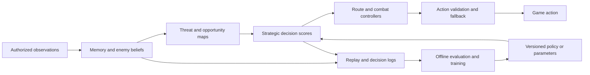

# Mech Royale bot: game sense and learning plan

Date: November 21, 2026. Status: researched proposal; gameplay implementation has not changed.

## Recommendation

Build on the existing survival-first bot with enemy belief tracking, risk-aware navigation, and explicit strategic decisions. Measure those improvements before introducing a trained policy. Use GPT to develop and review the system; keep immediate movement, aiming, and firing local and fast.

The objective should be better match results across unfamiliar opponents and seeds, not a promise of perfect decisions. A partially observed battle royale always involves uncertainty. Until the scoring rules are available, use win rate as the provisional primary outcome, with placement, survival, damage, and reliability as supporting measures.

## 1. What this repository currently contains

This is a TypeScript/Bun bot client for `mechfight/1`, not the game engine or a Fortnite/Apex integration.

| File | Current role |
| --- | --- |
| `main.ts` | Reads newline-delimited JSON from stdin, initializes the map from externally supplied files, seeds randomness, and answers the newest observation with an action on stdout. Includes warmup and an exception fallback. |
| `bot.ts` | Stateful, hand-written decision logic exposed as `makeBot(hello, map, rng).act(obs)`. Handles memory, threats, movement, loot, upgrades, aiming, and firing. |
| `map.ts` | Terrain and obstacle rasterization, clearance, visibility, static exposure, and coarse A* with path smoothing. |
| `Dockerfile` | Packages the bot using `oven/bun:1.4.4-slim`. |
| `package.json` | Module declaration only; no test scripts or dependencies are declared. |

Existing capabilities worth preserving:

- Projectile lead prediction, laser charge control, and mortar trajectory checks.
- Weapon-aware spacing, strafing, incoming-projectile avoidance, and charged-laser avoidance.
- Cover selection, hiding, predicted zone geometry, loot/crate memory, and stuck recovery.
- Enemy memory, damage bearings, sound alerts, and seeded random behavior.

The repository does not include the simulator, protocol specification, scoring rules, arena data, recorded observations, training pipeline, or evaluation harness. Code review establishes the implementation, but cannot establish its current win rate or physics accuracy.

## 2. Research and the capabilities we can borrow

We can implement precise aim, prediction, situational awareness, and fast decisions through this bot's authorized observation/action interface. Whether a particular input, training method, or external service is permitted in competition depends on the missing Mech Royale rules. This plan assumes the supplied bot interface and map are authorized.

Treat “hack bot” capabilities as functional inspiration: accurate targeting becomes projectile interception; apparent radar becomes a probability map derived from sightings and sounds. This proposal does not require game-client modification, hidden-state extraction, or anti-cheat evasion. No third-party cheat package or model was downloaded.

| Primary reference | What it establishes | Proposed adaptation |
| --- | --- | --- |
| [Epic: Understanding NPC Behaviors](https://dev.epicgames.com/documentation/fortnite/understanding-npc-behavior-in-unreal-editor-for-fortnite?lang=en-US) | UEFN documents state-based behavior, perception-related states, and navigation. This is creator NPC documentation, not disclosure of Fortnite's competitive bot internals. | Explicit strategic states and transitions, with inspectable reasons for decisions. |
| [EA: Apex Legends Breach patch notes](https://www.ea.com/games/apex-legends/apex-legends/news/breach-patch-notes) | Documents improvements to bot accuracy, drop distribution, ring survival, strafing, loadouts, and squad coherence. | Prioritize rotation and movement alongside aim. Evaluate loadout-aware decisions. Squad behavior applies only if our game actually has teams. |
| [OpenAI Five](https://openai.com/index/openai-five/) | Demonstrates recurrent policies and reinforcement learning through large-scale self-play in Dota 2. | A precedent for learned game sense and memory, not a directly transferable model or realistic initial compute budget for this repository. |

The reviewed sources do not provide a verified downloadable Fortnite/Apex policy suitable for this bot. Their mechanics and observation/action interfaces also differ. Reuse ideas, and check licensing and compatibility before incorporating any future code or weights.

## 3. Specific gaps revealed by the code

1. **Enemy memory does not model movement uncertainty.** Tracks retain the last position and velocity, but strategic threat checks use that position directly. Tracks are deleted after 20 seconds; the main `enemies` list uses only sightings younger than five seconds. Stored velocity currently helps targeting more than strategic prediction.
2. **Sound information is mostly an aiming hint.** Sounds and unseen damage update an alert bearing, rather than maintaining spatial evidence about possible opponents.
3. **Navigation does not use enemy risk.** `GameMap.path` already accepts an `extraCost(x, y)` callback, but `planTo` does not provide one. Static exposure influences hiding, not the full travel route.
4. **Smoothing can undo risk avoidance.** Both map string pulling and `followPath` shortcuts check walkability only. Adding A* risk penalties without changing these shortcuts could send the bot across the threat it just routed around.
5. **Zone reasoning uses fixed horizons.** It predicts the circle, but does not calculate route travel time, detours, energy availability, and storm damage together.
6. **Strategy relies on brittle assumptions.** Practice detection assumes an initial population of 16 and infers opponent behavior from deaths. Attacker classification uses IDs below/above 100. Verify these against the actual protocol before depending on them.
7. **Loot and upgrades use fixed priorities.** Weapon and upgrade rankings do not fully adapt to current loadout, remaining zone size, resources, or opponent style.
8. **Observation batching may lose transient evidence.** `main.ts` processes only the newest observation in a batch. If sounds/events are per-observation rather than cumulative, evidence from skipped observations is lost. Verify event lifetime and deduplication rules before changing ingestion.
9. **Navigation needs stronger failure semantics.** A* can return a partial path and can append the original goal after finding a nearby walkable cell. Direct movement is used when no waypoint is available. Distinguish reached, partial, and unreachable outcomes and validate final segments.
10. **No performance baseline exists in the repository.** Proposed improvements need measurements; apparent intelligence is not evidence of stronger play.

## 4. Proposed architecture

Keep `makeBot` as the external entry point. Extract focused modules incrementally once regression fixtures exist: `protocol.ts`, `belief.ts`, `threat.ts`, `strategy.ts`, and `telemetry.ts`. Preserve the fast combat controller initially. Any new runtime files must also be included in the Docker build.

### Enemy location beliefs: the first major feature

For each identified opponent, maintain the last confirmed sighting, estimated velocity, evidence age, confidence, and a distribution over reachable map cells. Keep anonymous sound evidence separately when it cannot reliably be associated with an ID.

- A visual sighting strongly concentrates the distribution near the observed position.
- After losing sight, briefly predict along velocity, then spread uncertainty over reachable routes as elapsed time grows. Do not extrapolate through walls indefinitely.
- Bias possible destinations toward safe-zone entrances, nearby cover, and contested resources. Treat these as hypotheses, not confirmed intentions.
- Convert sound bearings into broad directional regions; use distance categories only as supported by documented sensor semantics. A bearing alone is not an exact position.
- Reduce probability in areas the bot could actually observe but found empty. Visibility must account for sensor range, field of view, occlusion, and foliage; geometry alone is insufficient.
- Expire unreliable evidence and remove confirmed eliminated opponents when the protocol supports doing so.
- Track confidence separately from the conditional distribution of where an enemy could be. Avoid double-counting one sound as both a new enemy and an existing track.

Example: an enemy disappears behind a wall while the zone closes. Predict multiple reachable exits, give greater weight to exits toward safety, and route around the dangerous corridor. The bot should not keep treating the old position as current or declare the whole area safe after five seconds.

### Risk-aware routes and zone timing

Use a bounded, nonnegative extra navigation cost derived from expected exposure to opponents, weapon reach, static openness, and zone danger. Keep the belief grid coarse and cache expensive visibility calculations within a measured compute budget.

Conceptually:

`route cost = travel cost + expected combat risk + exposure cost + zone penalty`

Estimate arrival time along candidate routes using observed movement speed, terrain, boosts, and an energy reserve. Evaluate the interpolated zone at arrival times. A static A* penalty is an approximation; compare candidate routes with arrival-time checks first, and introduce time-dependent search only if measurements justify its complexity.

Preserve risk constraints during path smoothing and waypoint skipping. Invalidate cached routes when threat evidence or zone urgency materially changes. Avoid treating every suspected enemy as an impassable obstacle: the bot sometimes must accept risk to escape the zone.

### Encoded game sense before learned game sense

Score a small set of strategic choices, while retaining hard constraints for immediate survival and valid actions:

| Situation | Candidate decisions and evidence |
| --- | --- |
| Early game | Farm nearby resources while estimating contest risk and the time needed to rotate. |
| Midgame | Choose safe-side rotations, avoid chokepoints, and maintain multiple exits. |
| Favorable fight | Compare effective health, weapon ranges, reload/charge windows, cover, and escape routes. |
| Unfavorable fight | Break line of sight, preserve escape energy, and avoid retreating into another suspected opponent. |
| Nearby fight | Consider a third-party opportunity only with sufficient evidence, a short commitment window, and an exit. |
| Late game | Prioritize usable cover and final-circle access; increase willingness to engage when waiting removes options. |

Add hysteresis: require a meaningful advantage before switching plans, unless danger demands an immediate override. This prevents repeated fight/flee or loot/rotate oscillation.

Useful additional ideas:

- An information action: briefly scan a risky route before committing, if the protocol makes viewing direction matter.
- Adaptive upgrades based on owned weapons, energy bottlenecks, and expected engagement distance.
- Energy budgeting across escape boosts, lightning use, and movement.
- Engagement duration limits to reduce third-party exposure.
- Opponent-style estimates from repeated observed behavior, with conservative confidence.
- Decision explanations such as “rotate: arrival margin too small” or “evade: two likely firing angles.”

## 5. How the bot could actually learn

Start with learning between matches. Online memory adapts to the current match; it is not, by itself, a trained policy improving across matches.

| Stage | Method | Requirement and benefit |
| --- | --- | --- |
| A | Tune heuristic weights with random search or an evolutionary search | Needs repeatable match execution. Cheap way to improve existing fight, loot, and route scores. |
| B | Supervised prediction or imitation | Needs permitted replays with outcomes or strong demonstrations. Learn fight outcomes, danger estimates, or strategic choices. Copying the current bot alone also copies its weaknesses. |
| C | Small recurrent policy trained with PPO/self-play | Needs a fast, resettable simulator and training infrastructure. Learn strategic choices while retaining proven local movement/aiming logic. |
| D | Broader learned control | Consider only if the constrained policy beats the baseline reliably and inference remains within the runtime budget. |

For stage C, inputs should include health, energy, loadout, zone timing, local terrain, enemy beliefs, and recent history. Begin with discrete strategic actions such as rotate, collect, hold cover, engage, and disengage. A small recurrent network can carry history without sending each frame to an LLM.

Train against a mixture of frozen historical opponents, aggressive bots, passive bots, and varied seeds. Randomize supported game conditions to reduce overfitting. Use only actor-visible information as policy input; privileged simulator state, if permitted for training or evaluation, must remain isolated from live decisions.

Optimize the actual competition score once known. For a win-based objective, terminal victory is primary; modest intermediate rewards can guide learning. Watch for reward exploits such as hiding forever, farming damage, collecting resources without improving survival, or avoiding all fights until escape is impossible. Report win rate independently of training reward.

Export a frozen, versioned model for local inference, retain a deterministic fallback, and benchmark the actual Bun/container runtime before choosing an inference dependency. Training can use a separate environment without requiring Python or network access during matches.

## 6. Implementation sequence and acceptance gates

### Phase 0: specification, replay, and baseline

- Obtain the protocol, simulator command, scoring rules, representative map/observation files, and runtime limits.
- Verify sensor/event semantics, movement physics, supported training, and persistence rules.
- Add typed protocol boundaries, reproducible observation/action recording, and an evaluation runner. Keep protocol stdout clean; send diagnostics elsewhere.
- Capture current behavior as the baseline, including actual decision latency and startup time.
- Test initialization failure, invalid observations, action validity, and fallback behavior; repeating the previous movement command is not always a safe fallback.

Gate: a documented way to run seeded matches and compare a candidate to the unchanged baseline. Recorded playback tests alone cannot measure counterfactual win rate, because changing an action changes subsequent observations.

### Phase 1: enemy beliefs and risk-aware navigation

- Implement sightings, uncertainty growth, anonymous sound regions, confidence decay, and permitted negative evidence.
- Connect threat costs to A*, smoothing, shortcuts, route invalidation, and unreachable-goal handling.
- Add arrival-time-based zone checks and risk explanations.

Gate: controlled scenarios demonstrate occlusion uncertainty, sensible sound regions, no use of unavailable information, safe route shortcuts, and timely zone entry. Head-to-head evaluation shows whether these translate into better results.

### Phase 2: strategic decisions

- Introduce scored decisions and switching hysteresis.
- Add contextual loot/upgrades, weapon/resource-aware engagement assessment, and endgame behavior.
- Replace practice-mode and ID assumptions with protocol-supported information or explicit configuration.

Gate: compare each feature separately, inspect regressions, and retain only measured improvements or independently necessary correctness fixes.

### Phase 3: offline learning

- Start with tuning; collect a dataset before attempting imitation or RL.
- Keep training seeds, development seeds, and final evaluation seeds separate.
- Train a small strategic policy only after simulator throughput and compute cost are known.

Gate: improved held-out match results against diverse opponents, with no unacceptable reliability or latency regression. Otherwise retain the simpler controller.

## 7. Evaluation design

- Start with a provisional 200 paired matches per candidate, matching map/seed/slot/opponent setup where possible. Expand if outcome uncertainty is too large; 200 is a starting budget, not a guarantee of significance.
- Report win rate, placement, zone deaths, damage dealt/taken, early deaths, stuck time, and invalid-action/crash counts.
- Measure p50/p95/p99 decision time, memory, startup time, and missed deadlines against the actual host limits.
- Include unseen seeds, opponent styles, spawn slots, and supported maps. Report results separately for practice and competitive conditions.
- Use confidence intervals on paired outcome differences and publish the sample count. Do not pick a winner based on a few favorable games.
- Run feature ablations: beliefs only, navigation only, strategic scoring only, then combined. Watch whether avoiding enemies improves survival but hurts eventual wins.
- Preserve the best known policy, configuration, and replay examples to make regressions reproducible.

## 8. Which GPT model to use

For the initial architecture, implementation review, and difficult debugging, my recommendation is **GPT-6.2 Astra with High reasoning**, if available in your client. Use **GPT-6.2 Sol** for routine edits and smaller iterations when usage cost matters. This is a task-specific recommendation, not a claim that any model will perfect the bot. OpenAI's current [model guidance](https://learn.chatgpt.com/docs/models) recommends Astra for demanding work and Sol for everyday coding; it also describes higher reasoning settings for difficult multistep tasks.

For a future API integration, the documented model IDs are `gpt-6.2-astra` and `gpt-6.2-sol`; confirm access and benchmark the specific task. See the [current GPT guide](https://developers.openai.com/api/docs/guides/latest-model).

For live gameplay, start with **no GPT calls in the per-observation control loop**. The current client is designed to react to the newest observation; network latency and variable response time would complicate that requirement. Use GPT offline to analyze logs, propose strategies, review code, and design experiments. If an asynchronous strategic adviser is later tested, give it timestamped summaries, a strict deadline, and a local fallback; never block aiming or movement waiting for it.

The most valuable first implementation is the baseline harness followed by enemy beliefs plus risk-aware routing. It directly addresses the player's likely-location idea and creates the data needed for later learning.
